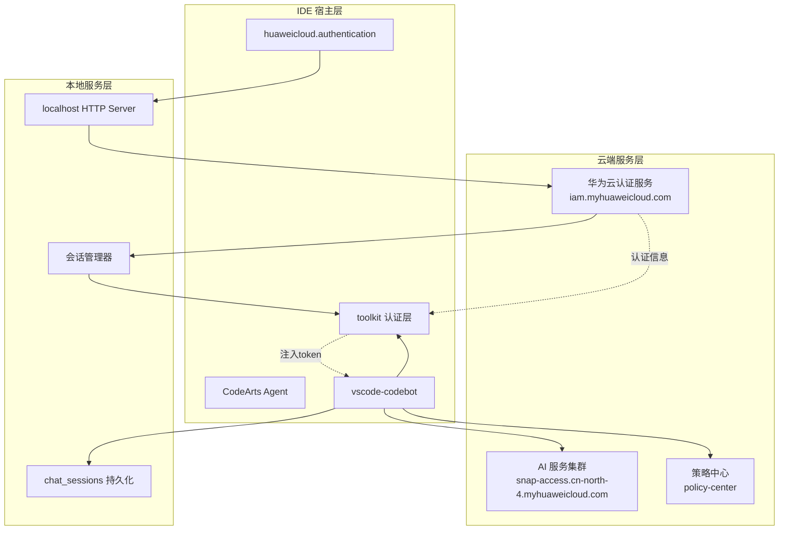
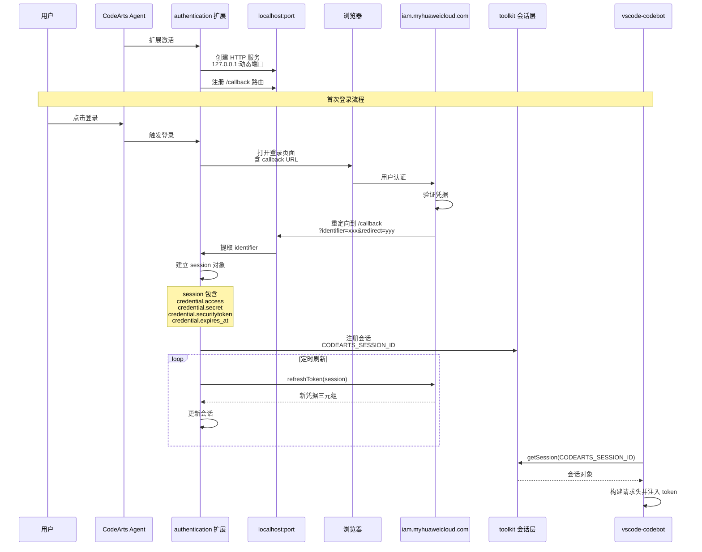

> 本文件由 codearts-agent-auth-and-requuest-mechanism.md 拆分而来。

# 华为云 CodeArts Agent 认证与请求机制技术文档

## 一、系统架构概述



### 核心组件职责

| 组件                         | 职责                           | 技术栈                           |
| ---------------------------- | ------------------------------ | -------------------------------- |
| `huaweicloud.authentication` | 认证扩展，管理用户会话         | Express + portfinder + crypto-js |
| `vscode-codebot`             | 主 AI 扩展，处理聊天和代码生成 | TypeScript + SSE                 |
| toolkit 会话层               | 跨扩展共享认证信息             | VS Code Authentication API       |
| localhost 回调服务           | 接收浏览器认证回调             | Express 动态端口                 |

---

## 二、认证机制详解

### 2.1 认证流程



### 2.2 本地回调服务实现

**关键代码位置**：`huaweicloud.authentication/dist/plugin.js`

**初始化流程**：

1. **创建服务**：使用 Express 创建 HTTP 服务
2. **绑定端口**：`listen(0, "127.0.0.1")` 动态分配端口
3. **端口检查**：若端口 < 10000，关闭并重试一次
4. **路由注册**：`GET /callback` 接收认证回调

**回调处理逻辑**：

```mermaid
flowchart TD
    A[/callback 收到请求] --> B{检查参数}
    B -->|缺少参数| C[返回错误 JSON<br/>lack argument identifier or redirect]
    B -->|参数完整| D[记录日志<br/>Receive the callback request]
    D --> E[保存 identifier<br/>this.identifier = i]
    E --> F[307 重定向<br/>t.redirect 307, a]

    G[会话建立] --> H[计算首次刷新时间<br/>expires_at - 当前时间 - 随机秒数]
    H --> I{是否需要立即刷新}
    I -->|是| J[立即执行 refreshToken]
    I -->|否| K[设置定时器<br/>setTimeout renewAndReuseSession]
```

**会话对象结构**：

```json
{
  "account": {
    "id": "用户ID",
    "label": "用户名"
  },
  "domainId": "域ID",
  "credential": {
    "access": "AK",
    "secret": "SK",
    "securitytoken": "临时令牌",
    "expires_at": "过期时间 ISO 8601"
  }
}
```

### 2.3 会话刷新机制

**刷新时间计算**：

- 首次刷新时间 = `expires_at - 当前时间 - 2小时 - 随机秒数`
- 随机秒数范围：`0-59`
- 若剩余时间 < 0，立即刷新

**刷新流程**：

1. 调用 `apiService.refreshToken(authentication)`
2. 获取新凭据：`access`、`secret`、`securitytoken`、`expires_at`
3. 更新本地会话对象
4. 记录日志：`renew session success` 或 `renew session error`
5. 若失败且未过期，继续定期刷新；若已过期，触发登出

### 2.4 错误处理模型

**错误类型枚举**：

| 错误常量               | 描述                    | 处理建议                 |
| ---------------------- | ----------------------- | ------------------------ |
| `UNAUTHORIZED`         | 认证错误                | 重新登录                 |
| `PROXY`                | 代理认证错误            | 检查代理设置             |
| `FORBIDDEN_TOKEN`      | IAM.1201                | Token 被禁用，联系管理员 |
| `FORBIDDEN_API_ACCESS` | not programmatic access | 用户仅支持控制台访问     |
| `TIMEOUT`              | 登录超时                | 检查网络并重试           |
| `FAILED`               | 登录失败                | 检查用户名密码           |
| `USER_OR_PWD`          | 用户名或密码错误        | 重新输入                 |
| `ACCOUNT_LOCKED`       | 账户锁定                | 15分钟后重试             |
| `ACCOUNT_DISABLED`     | 账户禁用                | 联系管理员               |

---