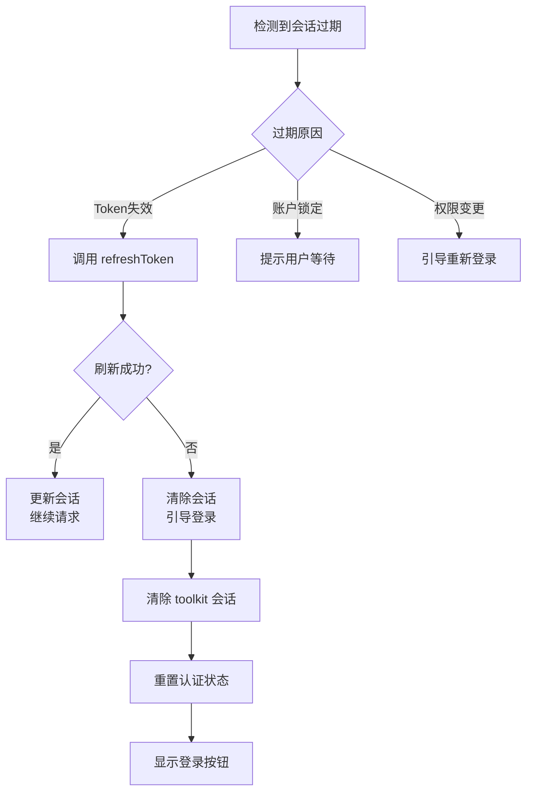
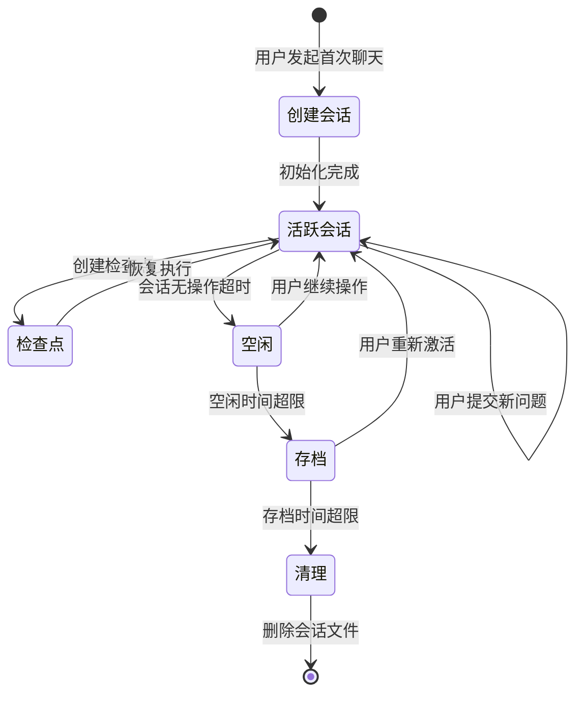

> 本文件由 codearts-agent-auth-and-requuest-mechanism.md 拆分而来。

## 五、关键数据结构

### 5.1 会话文件结构

**存储位置**：`chat_sessions/<session_id>/`

**文件清单**：

| 文件                 | 用途             | 主要字段                                             |
| -------------------- | ---------------- | ---------------------------------------------------- |
| `chat_baseInfo.json` | 会话基础信息     | `title`, `chatId`, `selectedGpt`, `contextToken`     |
| `messages_0.json`    | 消息列表（分片） | `sender`, `content`, `timestamp`, `collectionParams` |
| `checkpoint_*.json`  | 检查点数据       | 可选，用于断点续传                                   |

**chat_baseInfo.json 示例**：

```json
{
  "title": "会话标题",
  "timestamp": "2026-04-14T06:29:08.628Z",
  "chatId": "db35143a50684f9bb801ed78e91fb2a7",
  "selectedGpt": {
    "agent_id": "CodeAgent",
    "real_agent_id": "a8bcb36232554267a5142361cc25a393",
    "zh_name": "智能体"
  },
  "contextToken": 13358,
  "agentModeStatus": false
}
```

### 5.2 Agent 与模型映射

**Agent ID 映射**：

| Agent ID                 | Request ID                         | 描述          |
| ------------------------ | ---------------------------------- | ------------- |
| `CodeAgent`              | `fcde14d67a5444898db7a8d61681fb2d` | 代码智能体    |
| `CodeAgent` (real)       | `a8bcb36232554267a5142361cc25a393` | 实际 Agent ID |
| `DevMate`                | `8a635d538c274866abd130d66c4d9b20` | 开发助手      |
| `CodeMate`               | `4dbedc9dc49a468caacb5a007f3f4350` | 代码伙伴      |
| `Pangu_Doer_in_CodeArts` | `9f0e5cb64a104dcfb4aa90dbedab7dc9` | 盘古 Doer     |

**模型 ID**：

- 日志中显式出现：`GLM-5.1`
- 可能支持的其他模型可通过配置或策略获取

### 5.3 任务与参数类型

**任务类型**：

- `chat`：问答任务
- `code-explain`：代码解释
- `code-comment`：代码注释
- `code-debug`：代码调试
- `code-optimize`：代码优化
- `ut-generate`：单元测试生成
- `plan-execute`：规划执行

**触发类型**：

- `auto`：自动触发
- `manual`：手动触发
- `COMMENT_SLASH`：斜杠命令触发

---

## 六、实现路径与关键代码位置

### 6.1 认证扩展

**文件**：`huaweicloud.authentication/dist/plugin.js`

**关键类与方法**：

| 类/方法                   | 功能                       | 行号范围         |
| ------------------------- | -------------------------- | ---------------- |
| `initCallbackApiServer()` | 创建本地回调服务           | 约 46240-46310   |
| `startRenewSessionTask()` | 启动会话续期任务           | 约 46940-46950   |
| `renewAndReuseSession()`  | 执行会话续期               | 约 46980-47000   |
| `getSession()`            | 获取会话（供其他扩展调用） | 约 118830-118850 |

**会话常量**：

```javascript
// 行号约 101840
const CODEARTS_SESSION_ID = "huawei-cloud-authentication";
const TOOLKIT_PLATFORM_ID = "HuaweiCloud.huawei-cloud-toolkit-platform";
const DEVOPS_PLATFORM_ID = "huaweicloud.huaweicloud-devops-foundation";
```

### 6.2 AI 扩展

**文件**：`vscode-codebot/out/extension.js`

**关键类与方法**：

| 类/方法                             | 功能              | 行号范围           |
| ----------------------------------- | ----------------- | ------------------ |
| `construtNewFrameWorkAllUrl()`      | 构建所有 URL      | 约 135810-135830   |
| `initCommercialVersionUrl()`        | 初始化商业版 URL  | 约 135750-135800   |
| `initHcsVersionUrl()`               | 初始化 HCS 版 URL | 约 135700-135730   |
| `generateRequestBody()`             | 构建请求体        | 约 1220615-1220680 |
| `createChatStreamMessageFromJson()` | 处理 SSE 消息     | 约 1219080-1219140 |
| `sendChatRequest()`                 | 发送聊天请求      | 约 1229300-1229400 |

**产品配置加载**：

```javascript
// 从 product.json 加载配置
// 行号约 135750
this.productConfigs.commercialVersionDomain.newFramework.productDomain;
```

**日志标志**：

```javascript
// 行号约 157650
// "Hc or Hcs version, token is transferred by the toolkit."
// 标志着 token 注入点
```

---

## 七、配置与常量定义

### 7.1 产品配置

**商业版配置**：

```json
{
  "newFramework": {
    "codemateHomeUrl": "https://www.huaweicloud.com/product/codeartside/snap.html",
    "productDomain": {
      "codeGenDomain": "https://snap-access.cn-north-4.myhuaweicloud.com",
      "chatDomain": "https://snap-access.cn-north-4.myhuaweicloud.com",
      "knowledgeRepoListDomain": "https://snap-access.cn-north-4.myhuaweicloud.com/ragGateway",
      "policyCenterDomain": "https://snap-access.cn-north-4.myhuaweicloud.com",
      "agentModeDomain": "https://snap-access.cn-north-4.myhuaweicloud.com",
      "toolkitDomain": "https://iam.myhuaweicloud.com"
    }
  }
}
```

**HCS 版配置**：

```json
{
  "newFramework": {
    "productDomain": {
      "thirdTokenDomain": "自定义域名",
      "chatDomain": "自定义聊天域名",
      "codeGenDomain": "自定义代码生成域名"
    }
  }
}
```

### 7.2 功能开关

**featureSwitches**：

- `preferLanguageEnable`: 是否启用语言偏好
- `allowUploadFile`: 是否允许上传文件
- `hideAdvisorEntry`: 是否隐藏顾问入口
- `hideComplaintEntry`: 是否隐藏投诉入口
- `agentModeEnable`: 是否启用 Agent 模式
- `inlineChatEnable`: 是否启用内联聊天
- `knowledgeRepoSupportSearch`: 知识库搜索支持
- `codeDebugEnable`: 代码调试功能开启

### 7.3 会话管理常量

```javascript
// 会话存储目录
const CHAT_SESSIONS_DIR = "chat_sessions";
const MESSAGES_FILE_PREFIX = "messages_";
const BASE_INFO_FILE = "chat_baseInfo.json";

// 会话过期时间（毫秒）
const SESSION_EXPIRY_TIME = 2 * 60 * 60 * 1000; // 2小时

// 刷新时间随机范围
const REFRESH_RANDOM_SECONDS_MAX = 59;
```

---

## 八、错误处理机制

### 8.1 网络错误

**重试策略**：

- 最大重试次数：3 次
- 重试间隔：指数退避
- 超时时间：根据接口不同可配置

**错误分类**：

| 错误类型   | HTTP 状态码 | 处理方式                |
| ---------- | ----------- | ----------------------- |
| 网络超时   | -           | 重试 + 提示用户检查网络 |
| 认证失败   | 401         | 清除会话 + 引导重新登录 |
| 权限不足   | 403         | 提示联系管理员          |
| 服务不可用 | 503         | 重试 + 备用域名         |
| 队列拥塞   | 429         | 显示排队等待            |

### 8.2 业务错误

**错误码映射**：

| 错误码                    | 描述           | 用户提示         |
| ------------------------- | -------------- | ---------------- |
| `0`                       | 成功           | 无               |
| `IAM.1201`                | Token 禁用     | 联系管理员       |
| `not programmatic access` | 无编程访问权限 | 开通编程访问权限 |
| `Login Timeout`           | 登录超时       | 重新登录         |
| `Account Locked`          | 账户锁定       | 15分钟后重试     |

### 8.3 会话异常处理

**会话过期流程**：



---

## 九、会话管理与持久化

### 9.1 会话生命周期



### 9.2 持久化策略

**存储结构**：

```
codearts-agent/User/
├── chat_sessions/
│   ├── db35143a50684f9bb801ed78e91fb2a7/
│   │   ├── chat_baseInfo.json
│   │   ├── messages_0.json
│   │   ├── messages_1.json  # 消息分片存储
│   │   └── checkpoint_xxx.json
│   └── ...
├── globalStorage/
│   ├── state.vscdb          # 全局状态数据库
│   └── huaweicloud.codearts-snap/
│       └── state            # 扩展状态存储
└── workspaceStorage/
    └── <workspace-id>/
        └── state.vscdb      # 工作区状态
```

**消息归档策略**：

- 每个会话的消息按文件大小分片存储（`messages_0.json`, `messages_1.json`）
- 单个消息文件大小限制：约 5MB
- 最多保留最近 30 天的会话记录
- 清理策略：启动时自动清理过期会话

### 9.3 状态恢复

**恢复流程**：

1. 启动时扫描 `chat_sessions` 目录
2. 解析 `chat_baseInfo.json` 获取会话元数据
3. 加载最近的消息文件（`messages_n.json`）
4. 恢复 `StreamDataManager` 状态（`responseMessageId`、`ragReferences` 等）
5. 重建 UI 状态（用户输入框、历史消息列表）

---

## 十、开发建议

### 10.1 调试建议

**日志查看**：

- 认证日志：`logs/*/exthost/huaweicloud.authentication/HuaweiCloud Authentication.log`
- AI 日志：`logs/*/exthost/huaweicloud.codearts-snap/CodeArts代码智能体.log`

**关键日志标志**：

```
# 认证成功
"The HTTP API server has been started (localhost only), port: {port}"
"renew session success"

# 请求成功
"Send request success! description: ..."

# SSE 连接
"Build sse link trace id: {uuid}"
"Send sse request. description: build sse link for chat/code"

# 错误标志
"Error occurs during starting the HTTP API server"
"renew session error: ..."
```

**关键追踪点**：

- `traceId`：贯穿单个请求链路
- `response_message_id`：响应对应的请求标识
- `x-snap-traceid`：网络层追踪标识

### 10.2 扩展开发建议

**认证集成**：

```javascript
// 获取会话
const session = await authentication.getSession(
  "huawei-cloud-authentication",
  [],
);

// 会话对象包含
// session.account.id - 用户ID
// session.account.label - 用户名
// session.credential.access - AK
// session.credential.secret - SK
// session.credential.securitytoken - 临时令牌
```

**请求构建**：

```javascript
// 最小请求体
const minimalRequestBody = {
  chat_id: generateUUID(),
  messages: [{ type: "text", value: { input: "问题内容" } }],
  client: "IDE",
  task: "chat",
  is_delta_response: true,
};

// 完整请求体需要包含：
// - task_parameters（根据 task 类型填充）
// - parent_message_id（多轮对话）
// - model_id（可选，指定模型）
// - agent_id（可选，指定 Agent）
```

### 10.3 性能优化建议

**请求优化**：

1. **队列机制**：在高并发场景下，先调用 `queue/status` 检查负载
2. **增量处理**：严格处理 `is_delta_response`，累加文本片段
3. **连接复用**：保持 HTTP 连接，减少 TLS 握手开销

**状态管理**：

1. **惰性清理**：仅在访问会话时检查过期，而非定时扫描
2. **分片加载**：历史消息按需加载，避免一次性加载大文件
3. **增量持久化**：新消息追加到文件末尾，而非重写整个文件

### 10.4 安全建议

**认证安全**：

- 回调端口使用动态高位端口，避免固定端口被占用或攻击
- `identifier` 应为一次性令牌，回调后立即失效
- 会话凭据应加密存储，明文仅在内存中短暂存在

**请求安全**：

- 所有敏感请求使用 HTTPS
- 避免在日志中打印完整请求体/响应体（仅打印关键字段）
- 使用最小权限原则，请求必要字段而非全量获取

**会话安全**：

- 会话文件不应包含用户密码等敏感信息
- 存储路径应在用户目录内，避免跨用户访问
- 会话过期后应及时清理相关文件

---

## 十一、附录

### 11.1 完整 URL 映射表

| 变量名                 | 商业版 URL                                     | HCS 版 URL | 用途       |
| ---------------------- | ---------------------------------------------- | ---------- | ---------- |
| `chatUrl`              | `${chatDomain}/v1/chat/chat`                   | 自定义     | 聊天请求   |
| `startChatUrl`         | `${chatDomain}/v1/chat/start-chat`             | 自定义     | 初始化聊天 |
| `codeGenUrl`           | `${codeGenDomain}/v1/code/complete`            | 自定义     | 代码补全   |
| `_policyUrl`           | `${policyDomain}/v1/policy/bundle`             | 自定义     | 策略配置   |
| `_querySkillCenterUrl` | `${policyCenterDomain}/v1/skills-rules/list`   | 自定义     | 技能列表   |
| `gptsUrl`              | `${policyCenterDomain}/v1/agent-center/agents` | 自定义     | Agent 列表 |
| `_projectsExistUrl`    | `${chatDomain}/snap-manager/v1/user/project`   | 自定义     | 用户项目   |
| `toolkitIAMLoginUrl`   | `${toolkitDomain}/v3/auth/tokens`              | 自定义     | 认证令牌   |

### 11.2 常见错误排查

| 问题现象       | 可能原因               | 排查步骤                         |
| -------------- | ---------------------- | -------------------------------- |
| 登录无响应     | 回调端口被占用         | 检查日志中的端口号，确认无冲突   |
| 会话立即过期   | 系统时间不同步         | 校准系统时间，检查时区设置       |
| 请求返回 401   | 会话过期或 token 失效  | 清除会话，重新登录               |
| SSE 连接中断   | 网络不稳定或服务端超时 | 检查网络，增加重连机制           |
| 代码补全无响应 | 队列拥塞               | 检查 `/api/v1/queue/status` 响应 |

### 11.3 参考配置示例

**product.json 片段**：

```json
{
  "isCommercialVersion": true,
  "isNewFramework": true,
  "commercialVersionDomain": {
    "newFramework": {
      "productDomain": {
        "chatDomain": "https://snap-access.cn-north-4.myhuaweicloud.com",
        "codeGenDomain": "https://snap-access.cn-north-4.myhuaweicloud.com",
        "policyCenterDomain": "https://snap-access.cn-north-4.myhuaweicloud.com",
        "toolkitDomain": "https://iam.myhuaweicloud.com"
      }
    }
  }
}
```

---

**文档版本**：v1.0  
**最后更新**：2026年  
**基于数据源**：CodeArts Agent 用户数据、日志、配置文件及授权格式化后的插件代码
