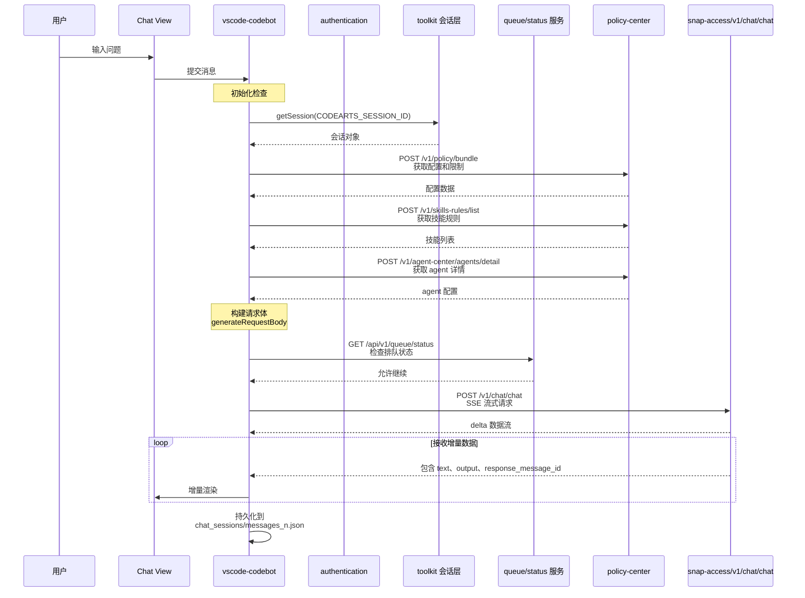
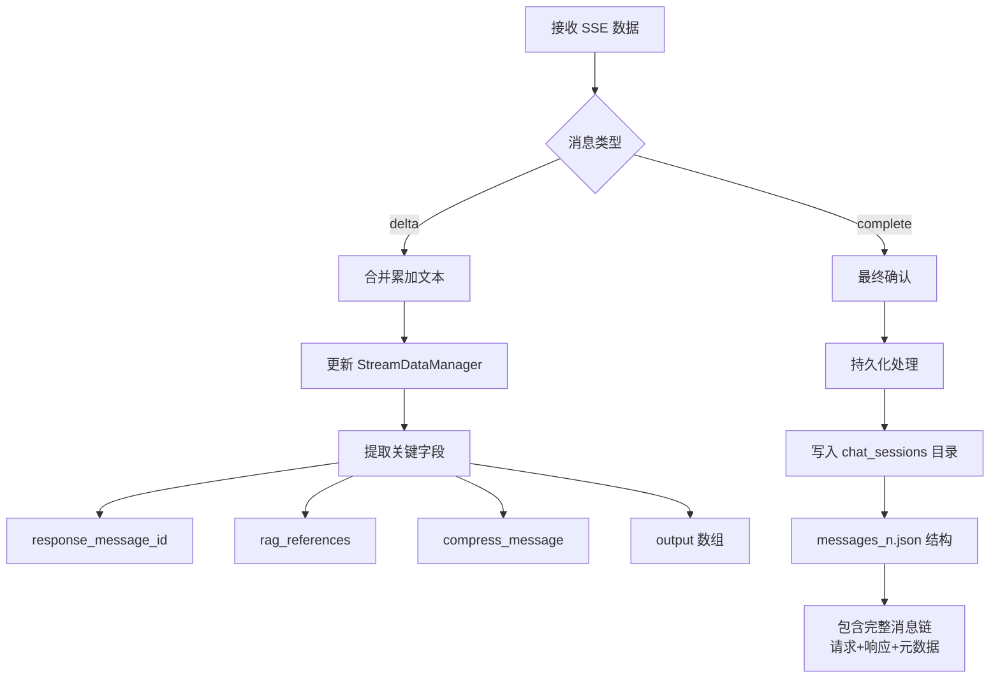

> 本文件由 codearts-agent-auth-and-requuest-mechanism.md 拆分而来。

## 三、LLM 请求机制详解

### 3.1 请求链路



### 3.2 请求体结构构建

**核心函数**：`generateRequestBody(e, x)`

**聊天模式请求体（已验证通过 — 2026-04-16 CDP 抓包确认）**：

```json
{
  "chat_id": "UUID无连字符(32位hex)",
  "messages": [
    {
      "type": "text",
      "content": "用户输入文本"
    }
  ],
  "client": "IDE",
  "task": "plan-execute",
  "task_parameters": {
    "codebase_search": false,
    "preferred_language": "zh-cn",
    "enable_code_interpreter": false,
    "projectLevelPrompt": "",
    "isSubAgent": false,
    "tools": [
      {
        "type": "function",
        "function": { "name": "...", "description": "...", "parameters": {...} }
      }
    ],
    "environmentDetails": {
      "osVersion": "win32",
      "currentDate": "2026-04-16T14:54:23.000182",
      "currentWorkingDirectory": "d:\\path\\to\\project"
    },
    "routerVersion": "v2",
    "isNewClient": true,
    "features": { "support_end_tag": true },
    "contexts": [],
    "expert_rules": [],
    "ide": "CodeArts Agent"
  },
  "batch_task_parameters": [],
  "attempt": 1,
  "user_id": "华为云账号名",
  "agent_id": "CodeAgent",
  "parent_message_id": "UUID无连字符(32位hex)",
  "is_delta_response": true,
  "model_id": "Glm-4.7-internal"
}
```

> **关键发现（2026-04-16）**：
>
> - `messages[].content` 是字符串，**不是** `messages[].value.input` 对象格式
> - `model_id` 实际使用 `"Glm-4.7-internal"`（可能因用户策略不同而变化）
> - `attempt` 应为 `1` 而非 `0`
> - `environmentDetails` 是对象而非空字符串
> - 不需要发送 `trigger_mode`, `master_body`, `mcp_servers` 字段
> - **版本号必须与 IDE 一致**，否则返回 `ChatAgent.00001205`（版本过旧）

**默认工具列表（12个）**：
Task, Bash, Glob, Grep, Read, Edit, Write, TodoWrite, ask_followup_question, openBrowserInIDE, SkillTool, analyzeImage

工具定义详见 `scripts/tools-definition.mjs`。

### 3.2.1 三种已验证请求变体

#### 标准聊天请求

- `messages` 包含当前用户输入
- `task_parameters.isSubAgent = false`
- 使用 12 个默认工具
- `chat_id` 和 `parent_message_id` 在同一会话内应持续复用/推进

#### 子代理请求

- `task_parameters.isSubAgent = true`
- 包含 `subAgent_type` 与 `subAgent_prompt`
- 工具集缩减为子代理所需工具（当前抓包确认最少为 `Bash/Glob/Grep/Read/openBrowserInIDE`）

#### Tool continuation 请求

- `messages: []`
- `task_parameters.tool_result` 携带上一步工具执行结果
- 仍复用同一个 `chat_id`
- `parent_message_id` 指向上一步响应消息链

### 3.2.2 当前代理新增的 OpenAI 兼容扩展字段

为了让非 IDE 客户端也能继续同一条 CodeArts 对话链，代理额外接受以下扩展字段：

```json
{
  "conversation_id": "代理侧会话ID",
  "codearts": {
    "model_id": "可选，显式指定上游 model_id",
    "preferred_language": "zh-cn",
    "codebase_search": false,
    "current_working_directory": "d:\\workspace",
    "tool_results": [
      {
        "name": "Bash",
        "result": "...",
        "arguments": { "command": "dir" },
        "toolCallId": "call_xxx"
      }
    ],
    "sub_agent": {
      "type": "Explore",
      "prompt": ""
    }
  }
}
```

说明：

- `conversation_id` 用于复用代理本地持久化的会话线程状态
- `codearts.tool_results` 用于触发上游 `task_parameters.tool_result` 模式
- `codearts.sub_agent` 用于触发子代理请求模式
- `codearts.current_working_directory` 或 `codearts.workspace_root` 应显式传入真实项目目录；如果未传，代理会退回到 `user` 字段，再退回到代理进程当前目录
- 这些字段是代理扩展，不属于 OpenAI 官方标准字段

### 3.2.3 工具参数命名注意事项

代理发送给 CodeArts 的工具 schema 使用真实 IDE 抓包中的字段命名，尤其是 camelCase：

- `Read` 使用 `filePath`
- `Edit` 使用 `filePath` / `oldString` / `newString` / `replaceAll`
- `Write` 使用 `filePath`

如果工具 schema 与 IDE 不一致，模型虽然会发起工具调用，但参数可能无法通过宿主侧校验。

### 3.2.4 SSE 响应体结构（已验证通过）

**首包（元数据）**：

```json
{
  "id": "消息ID",
  "model": "glm-4.7",
  "type": "answer",
  "chat_id": "会话ID",
  "response_message_id": "响应消息ID",
  "request_message_id": "请求消息ID",
  "agent_name": "CodeAgent",
  "is_delta_response": true,
  "is_model_auto_switched": false,
  "prompt_id": "local",
  "prompt_tokens": 0,
  "rag_references": [],
  "rag_flywheel": [],
  "long_term_memory_info": { "has_long_memory_data": false },
  "query_optimize": false
}
```

**后续 delta 包**：

```json
{
  "delta": {
    "role": "assistant",
    "content": "增量文本",
    "reasoning_content": null,
    "tool_calls": null
  },
  "prompt_tokens": 0,
  "completion_tokens": 0,
  "total_tokens": 0
}
```

代理在 OpenAI 响应中还会额外附带：

- `conversation_id`：代理侧会话线程 ID
- `codearts.chat_id`
- `codearts.response_message_id`
- `codearts.request_message_id`
- `codearts.model_id`

当上游返回工具调用时，代理会把 `delta.tool_calls` / `message.tool_calls` 转换为 OpenAI 兼容结构，并在后续请求中允许客户端通过 `codearts.tool_results` 续传。

**结束标志**：

```
data:[DONE]
```

**代码生成模式请求体**：

```json
{
  "file_path": "文件路径",
  "above_text": "光标上方内容",
  "below_text": "光标下方内容",
  "request_type": "completion",
  "trigger_type": "auto|manual",
  "chat_id": "会话ID",
  "ide_type": "CodeArts Agent",
  "plugin_version": "版本号",
  "language": "编程语言",
  "retry": 0,
  "model_id": "模型ID",
  "generation_length": "DEFAULT",
  "topN": 1,
  "code_mode": "single_line|multi_line",
  "ide_version": "IDE版本",
  "trigger_mode": "触发模式",
  "knowledge_ids": [],
  "task_parameters": {},
  "master_body": "..."
}
```

### 3.3 响应体结构处理

**SSE 增量响应结构**：

```json
{
  "id": "消息ID",
  "model": "glm-5.1",
  "type": "answer",
  "chat_id": "会话ID",
  "response_message_id": "响应消息ID",
  "request_message_id": "请求消息ID",
  "agent_name": "CodeAgent",
  "is_delta_response": true,
  "is_model_auto_switched": false,
  "prompt_id": "local",
  "prompt_tokens": 0,
  "rag_references": [],
  "rag_flywheel": [],
  "long_term_memory_info": {
    "has_long_memory_data": false
  },
  "query_optimize": false,
  "text": "增量文本片段",
  "output": [
    {
      "type": "output_text",
      "text": "完整输出",
      "name": null,
      "id": null,
      "arguments": {}
    }
  ],
  "error_code": "0"
}
```

**消息处理流程**：



### 3.4 队列机制

**队列状态检查**：

- **清空队列**：`DELETE /api/v1/queue/status`
- **轮询状态**：`GET /api/v1/queue/status`

**应用场景**：

- 在发起 `/v1/chat/chat` 前检查排队状态
- 防止并发请求超出服务限制
- 优雅处理服务端拥塞情况

---

## 四、接口清单与请求规范

### 4.1 认证相关接口

| 接口                                 | 方法 | 域名            | 用途           |
| ------------------------------------ | ---- | --------------- | -------------- |
| `/v3/auth/tokens`                    | POST | `toolkitDomain` | 获取认证令牌   |
| `/v3.0/OS-CREDENTIAL/securitytokens` | POST | `toolkitDomain` | 获取临时 AK/SK |
| `/v3/auth/domains`                   | GET  | `toolkitDomain` | 获取域信息     |
| `/snap-manager/v1/login/ticket`      | POST | `chatDomain`    | Web 登录票据   |
| `/snap-manager/v1/token/renew`       | POST | `chatDomain`    | 会话续期       |

### 4.2 AI 服务接口

| 接口                        | 方法       | 用途               | 请求体关键字段                                     |
| --------------------------- | ---------- | ------------------ | -------------------------------------------------- |
| `/v1/chat/chat`             | POST (SSE) | 聊天流式请求       | `chat_id`, `messages`, `task`, `is_delta_response` |
| `/v1/chat/start-chat`       | POST       | 初始化聊天会话     | `user_id`, `client`                                |
| `/v1/chat/management/event` | POST       | 聊天反馈事件       | `chat_id`, `event_type`                            |
| `/v1/code/complete`         | POST (SSE) | 代码补全流式请求   | `file_path`, `above_text`, `below_text`            |
| `/v1/code/start-chat`       | POST       | 初始化代码生成会话 | 类似聊天初始化                                     |
| `/v1/code/management/event` | POST       | 代码生成反馈       | 反馈数据                                           |

### 4.3 配置与管理接口

| 接口                                   | 方法       | 用途                    |
| -------------------------------------- | ---------- | ----------------------- |
| `/v1/policy/bundle`                    | POST       | 获取策略包配置          |
| `/v1/skills-rules/list`                | POST       | 获取技能规则列表        |
| `/v1/skills-rules/skills/download_url` | GET        | 获取技能下载地址        |
| `/v1/agent-center/agents/detail`       | POST       | 获取 Agent 详细信息     |
| `/v1/agent-center/agents/useragents`   | POST       | 获取用户可用 Agent 列表 |
| `/snap-manager/v1/user/project`        | GET        | 获取用户项目列表        |
| `/api/v1/queue/status`                 | GET/DELETE | 队列状态检查与清理      |

### 4.4 请求头规范（已验证通过 — 2026-04-16）

**HC 模式（华为云版）必需请求头**：

```
Content-Type: application/json
Accept: text/event-stream
Authorization: SDK-HMAC-SHA256 Access=<AK>, SignedHeaders=<签名头列表>, Signature=<签名>
X-Sdk-Date: <ISO日期 YYYYMMDDTHHmmssZ>
X-Security-Token: <临时安全令牌>
Agent-Type: ChatAgent
X-Language: zh-CN
x-snap-traceid: <UUID无连字符>
client_version: 26.3.5
plugin-name: codearts-snap_vscode
plugin-version: 26.3.5
ide-name: CodeArts Agent
ide-version: 26.3.11
is_confidential: false
heartbeat-enable: true
```

> **版本号关键**：`client_version`、`plugin-version`、`ide-version` 必须与 IDE 安装版本一致。
> 过旧版本会返回 `ChatAgent.00001205`（当前版本已不再维护）。
>
> - `client_version` / `plugin-version` → 来自扩展 `package.json` 的 version
> - `ide-version` → 来自 IDE `product.json` 的 version

**签名头说明**：

- 签名仅包含 `content-type; host; x-sdk-date; x-security-token` 四个 header
- `Authorization` 和 `X-Security-Token` 不参与签名
- URI 路径需要尾部斜杠（APIG 规范化）

**生成方式**：

- 追踪 ID 通常为 UUID 格式（无连字符）
- 在代码生成请求中，`traceId` 和 `request_id` 可能相同
- 响应头中可能包含 `x-snap-traceid` 用于网络层追踪

---

## 八、Proxy 字段来源规则

代理在构造上游 `task_parameters` 时，每个字段按以下三类规则填充：

### 8.1 字段来源分类

| 类型                  | 含义                   | 缺失时行为                                           |
| --------------------- | ---------------------- | ---------------------------------------------------- |
| **PASSTHROUGH**       | 优先来自调用方显式传入 | 缺失时用空值（`""`、`[]`），**不从代理运行环境推断** |
| **PROTOCOL**          | 协议固定值，由抓包确认 | 不受调用方控制，始终使用固定值                       |
| **CALLER_OR_DEFAULT** | 优先来自调用方         | 缺失时使用抓包对齐的固定默认值                       |

### 8.2 各字段归属

| 字段                                         | 类型              | 调用方传入路径                                                    | 默认值                                      |
| -------------------------------------------- | ----------------- | ----------------------------------------------------------------- | ------------------------------------------- |
| `environmentDetails.currentWorkingDirectory` | PASSTHROUGH       | `codearts.current_working_directory` 或 `codearts.workspace_root` | `""`                                        |
| `environmentDetails.osVersion`               | CALLER_OR_DEFAULT | `codearts.os_version`                                             | `"win32"`                                   |
| `environmentDetails.currentDate`             | PROTOCOL          | —                                                                 | 代理生成当前时间                            |
| `preferred_language`                         | CALLER_OR_DEFAULT | `codearts.preferred_language`                                     | `"zh-cn"`                                   |
| `codebase_search`                            | CALLER_OR_DEFAULT | `codearts.codebase_search`                                        | `false`                                     |
| `enable_code_interpreter`                    | CALLER_OR_DEFAULT | `codearts.enable_code_interpreter`                                | `false`                                     |
| `projectLevelPrompt`                         | CALLER_OR_DEFAULT | `codearts.project_level_prompt`                                   | `""`                                        |
| `contexts`                                   | PASSTHROUGH       | `codearts.contexts`                                               | `[]`                                        |
| `expert_rules`                               | PASSTHROUGH       | `codearts.expert_rules`                                           | `[]`                                        |
| `routerVersion`                              | PROTOCOL          | —                                                                 | `"v2"`                                      |
| `isNewClient`                                | PROTOCOL          | —                                                                 | `true`                                      |
| `features`                                   | PROTOCOL          | —                                                                 | `{ support_end_tag: true }`                 |
| `ide`                                        | PROTOCOL          | —                                                                 | `"CodeArts Agent"`                          |
| `tools`                                      | PROTOCOL          | —                                                                 | 由代理作为宿主角色提供，必须与真实 IDE 对齐 |
| `isSubAgent`                                 | PROTOCOL          | `codearts.sub_agent`                                              | `false`                                     |

### 8.3 核心原则

> **代理的职责是授权 / 鉴权 / 会话保持 / 协议适配，不是替调用方"脑补上下文"，也不是将代理自身的运行环境混入上游请求。**

- `process.cwd()` 绝不出现在上游请求中
- `process.platform` 绝不出现在上游请求中
- 调用方若未提供工作目录，上游收到空字符串，而非代理进程目录
