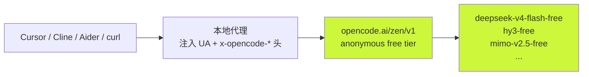
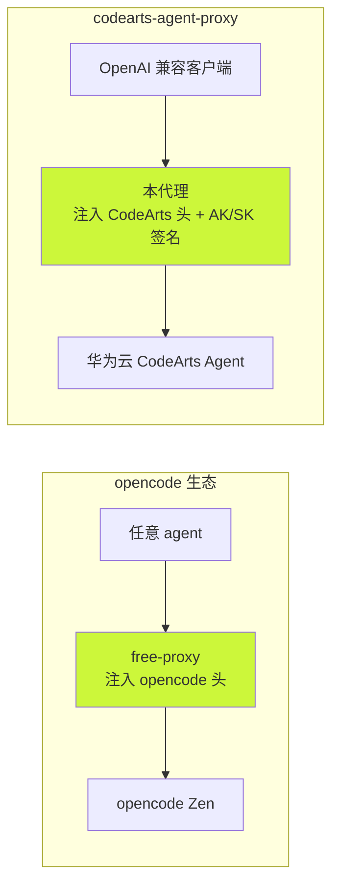

# opencode free 模型代理生态调研

**调研日期：** 2026-08-22
**调研动机：** 了解社区有哪些项目能把 opencode 的 free 模型代理成 OpenAI 兼容接口，供任意 agent 使用；评估是否对当前 codearts-agent-proxy 有借鉴价值。

---

## 1. 背景：opencode 的 free 模型到底是什么

opencode 通过 **OpenCode Zen**（自研 AI gateway）提供模型访问，分两个 tier：

```
opencode Zen
   │
   ├─ 付费 tier：BYOK / 按请求计费（GPT-5.x、Claude、Gemini...）
   │
   └─ anonymous free tier  ← 社区想"代理出来"的就是这个
         │
         ├─ 模型带 -free 后缀：
         │    deepseek-v4-flash-free
         │    hy3-free
         │    mimo-v2.5-free
         │    nemotron-3-super-free
         │    qwen3.6-plus-free
         │    minimax-m2.5-free
         │
         └─ 准入门槛：请求必须带特定 User-Agent + x-opencode-* 头
                       其他 agent 直接打 → 429 FreeUsageLimitError
```

**关键事实：** free 模型并非公开 API，而是 opencode 客户端独享的 anonymous 配额。其他 agent（Cursor、Cline、Aider、curl）直接请求会被 `429 FreeUsageLimitError` 或 `AuthError` 拒绝。

opencode 客户端身份由以下硬编码头构成（reverse engineer 自 opencode binary）：

```
Authorization: Bearer public
User-Agent: opencode/1.15.0 ai-sdk/provider-utils/4.0.23 runtime/bun/1.3.13
x-opencode-client: cli
x-opencode-project: global
x-opencode-request: msg_<uid>
x-opencode-session: ses_<uid>
```

---

## 2. "代理出来"的本质

社区项目的核心套路是：**本地起一个 OpenAI 兼容服务，注入 opencode 的身份头，转发到 `opencode.ai/zen/v1`，让任何工具都能白嫖 free 模型。**



---

## 3. 社区项目对比

| 项目 | 语言 | Stars | 定位 | 特色 |
|------|------|-------|------|------|
| `bigdata2211it-web/opencode-free-proxy` | JS | 88 | 同时暴露 OpenAI + Anthropic 两套 API | 30 秒 setup；systemd 服务；头来自 reverse engineer opencode binary |
| `12errh/zen-proxy` | JS | 9 | 纯 OpenAI 兼容，零依赖 | Dashboard + 配置热更新 + BYOK；明确警告"别滥用 IP 轮换" |
| `stevef1uk/freeride` | Go | 3 | 代理 OpenRouter 的 free 模型给 opencode | 方向相反：给 opencode 喂 OpenRouter free，而非把 opencode free 代理出来 |
| `IngARodriguez/openapis` | - | 34 | 统一代理 free Claude + free OpenAI | drop-in 兼容 Anthropic SDK / OpenAI SDK / Claude Code / opencode |
| `RunMintOn/OpenCode-Qwen-Proxy` | TS | 29 | OAuth 插件，用 qwen.ai 账号 | 2000 req/day free，走 Qwen3.5Plus-Coder |
| `Ritard563/dsh-opencode` | JS | 3 | 反向代理给 DeepSeek Harness 用 | 场景很窄 |
| `alexjm19/free-llm-api-provider` | JS | 3 | 238 模型 / 25+ free provider 自动 failover | 通用 free 聚合，不限于 opencode |
| `tashfeenahmed/freellmapi` | TS | 19.3k | 29 provider / 358 endpoint / 4B tokens/月 聚合 | 当前最热门；多模态(chat+embedding+image+audio)；per-key 用量追踪；ToS 逐 provider 审查 |

### 3.1 两个主流方案的方向差异

```mermaid
graph TB
    subgraph 方案A["方案 A：opencode-free-proxy / zen-proxy<br/>把 opencode Zen free 代理出来"]
        A1[Cursor / Cline / curl] --> A2[本地代理<br/>注入 UA + x-opencode 头]
        A2 --> A3["opencode.ai/zen/v1<br/>anonymous free tier"]
    end

    subgraph 方案B["方案 B：freeride<br/>把 OpenRouter free 喂给 opencode"]
        B1["OpenRouter free 模型"] --> B2[本地 Go 代理]
        B2 --> B3[opencode CLI]
    end

    subgraph 方案C["方案 C：freellmapi / free-llm-api-provider<br/>聚合多家 free tier，不绑定 opencode"]
        C1[任意 OpenAI client] --> C2[本地聚合代理<br/>路由 + failover + 用量追踪]
        C2 --> C3["Groq / NVIDIA / Gemini /<br/>OpenRouter / ... 各家 free key"]
    end

    style A3 fill:#ccf73a
    style B1 fill:#ccf73a
    style C3 fill:#ccf73a
```



---

## 4. 代表项目详解

### 4.1 `bigdata2211it-web/opencode-free-proxy`（最高 star，88）

- **语言：** JavaScript（Node.js）
- **暴露 API：** 同时支持 OpenAI 格式（`POST /v1/chat/completions`）和 Anthropic 格式
- **可用模型：**

| 模型 | 实际是 | 稳定性 |
|------|--------|--------|
| `deepseek-v4-flash-free` | DeepSeek V4 Flash | Solid |
| `big-pickle` | DeepSeek V4 Flash（别名） | Solid |
| `minimax-m2.5-free` | MiniMax M2.5 | Solid |
| `nemotron-3-super-free` | NVIDIA Nemotron 3 Super | Hit or miss |
| `qwen3.6-plus-free` | Qwen 3.6 Plus | Intermittent |

- **工作原理：** 代理在转发时注入 `x-opencode-*` 认证头，这些头是 reverse engineer opencode binary 得到的。没有这些头，即使带 `Authorization: Bearer public` 也会被 `AuthError` 拒绝。
- **部署：** 提供 systemd service unit，可一键 `sudo systemctl enable --now opencode-proxy`。

### 4.2 `12errh/zen-proxy`（设计最完整）

- **语言：** JavaScript，零依赖
- **暴露 API：** 纯 OpenAI 兼容（`/v1/chat/completions` + `/v1/models` + `/v1/responses` passthrough）
- **亮点：**
  - Web Dashboard（`/`）
  - 配置热更新（`GET/PUT /api/config`）
  - 模型测试端点（`POST /api/test`）
  - 日志 tail（`GET /api/logs`）
  - BYOK：可设置自己的 Zen key 获得稳定配额
  - 模型别名、fallback 链、自动同步上游模型列表
- **诚实警告：**
  > This rides opencode's anonymous free tier: per-IP request/daily quotas and a shared pool that's sometimes saturated. Don't rotate/abuse IPs or run heavy workloads anonymously.
  > The `-free` models are "as-is" free tiers — expect rate limits and occasional provider errors.
  > For anything serious, BYOK.

### 4.3 `stevef1uk/freeride`（方向相反）

- **语言：** Go
- **作用：** 代理 OpenRouter 的 free 模型，喂给 opencode CLI 用
- **意义：** 不属于"把 opencode free 代理出来"的范畴，但展示了另一个方向——用 OpenRouter 的 free 池替代 Zen free

### 4.4 `tashfeenahmed/freellmapi`（聚合系头号项目，19.3k star）

- **语言：** TypeScript（Node.js），MIT，有 Docker 镜像（ghcr.io）和 CI
- **规模：** 29 个 free LLM provider / 358 个 free model endpoint / 251 个 model family，号称 4B tokens/月
- **暴露 API：** 单一 OpenAI 兼容 `/v1` 端点，支持 chat + embedding + image + audio 四种模态
- **核心机制：**
  - **路由器主动选优**：不只是 failover，而是根据健康状态主动选当前最优模型
  - **per-key 用量追踪**：追踪每个 key 的用量，确保不超各家 free tier cap
  - **key 加密存储**
  - **circuit breaker**：临时跳过失败 provider
  - **多 key 轮换**：每个 provider 支持多 key，逐个尝试后才 failover
- **客户端生态：** 独立域名 `freellmapi.co`，Google Play / macOS / Windows 客户端，i18n 含简体中文
- **合规态度：** `docs/architecture.md` 逐 provider 审查 ToS（2026-05），README 明确声明"for personal experimentation, not production"
- **和 opencode 系的区别：** 不依赖 opencode Zen 的 anonymous free tier，要求用户自己去各家 provider 注册 free key（Groq、NVIDIA、Gemini、OpenRouter 等都有 free tier），然后聚合 + failover。属于"聚合系"，和 opencode 系（4.1/4.2）是不同路线。
- **和 `alexjm19/free-llm-api-provider` 的关系：** 同属聚合系，但 freellmapi 规模大得多（19.3k vs 3 star，29 vs 25 provider，358 vs 238 model），且多了多模态、per-key 用量追踪、ToS 审查、多端客户端等特性。alexjm19 的健康检查核心复用自 `free-coding-models` 项目，freellmapi 则是自研。

---

## 5. 风险与合规评估

### 5.1 技术风险

| 风险 | 说明 |
|------|------|
| per-IP 配额 | anonymous free 按 IP 限流，共享池有时饱和 |
| 模型 as-is | `-free` 模型有 rate limit 和偶发 provider error，稳定性远不如 BYOK |
| 头失效 | opencode 团队随时可能改头或加签名（类似本项目的 `sign.ts` AK/SK 签名），到时这些代理会集体失效 |

### 5.2 合规灰色地带

reverse engineer 客户端头绕过身份检查，本质上是**冒充 opencode 客户端**。这与本项目 `sign.ts` 的处境类似——华为云 CodeArts 也依赖客户端身份头（`IDE_VERSION` / `PLUGIN_VERSION` 必须匹配服务端，随意修改会导致请求被拒）。

### 5.3 正经用法

去 Zen 注册账号拿 free key，然后 BYOK 模式接这些代理，既稳定又合规。

---

## 6. 对 codearts-agent-proxy 的借鉴价值

### 6.1 架构相似性



本项目已经在做"OpenAI 兼容代理 + 注入上游身份"的事，方向完全一致。区别在于：
- opencode free-proxy 注入的是 **固定硬编码头**（reverse engineer 得来）
- 本项目注入的是 **动态签名**（OAuth2 + PKCE + DPoP + AK/SK HMAC-SHA256），复杂度高一截

### 6.2 可借鉴的点

1. **双格式暴露**：opencode-free-proxy 同时暴露 OpenAI + Anthropic 两套 API。本项目目前只暴露 OpenAI 格式，若要支持 Claude Code 等工具，可参考其 Anthropic 格式转换层。
2. **Dashboard + 配置热更新**：zen-proxy 的 `/api/config` 热更新思路，比本项目重启改 env 的体验好。
3. **BYOK 分级**：zen-proxy 区分 anonymous（`Bearer public`）和 BYOK 两种模式，本项目目前强依赖用户自己的 CodeArts 账号，没有 anonymous tier 概念。
4. **模型别名 + fallback 链**：zen-proxy 的 `MODEL_ALIASES` + `FALLBACK_MODELS`，可参考用于本项目的模型缓存三级降级。
5. **per-key 用量追踪**（freellmapi）：追踪每个 key 的用量确保不超 free tier cap。本项目有 API Key 体系（`src/store/` + `ApiKey` model），但目前只做认证不做配额追踪，可借鉴做 per-key 限流/配额。
6. **路由器主动选优**（freellmapi）：不只是 failover，而是根据健康状态主动选当前最优模型。本项目有"模型缓存三级降级"但只是降级不是选优。
7. **ToS 合规审查落文档**（freellmapi）：逐 provider 审查 ToS 并写进 `docs/architecture.md`。本项目上游是华为云正式 API 有合法账号，合规性更强，但可借鉴"把合规审查落成文档"的做法。

### 6.3 不建议借鉴的点

- **reverse engineer 硬编码头**：本项目上游是华为云正式 API，有合法账号体系，不应走冒充客户端的路子。
- **anonymous free tier**：华为云 CodeArts 没有公开的 anonymous free tier，这个套路不适用。

---

## 7. 结论

社区项目分两条路线：

1. **opencode 系**（把 opencode Zen free 代理出来）：核心套路是**本地代理 + 注入 reverse engineer 得来的客户端身份头**。最成熟的是 `bigdata2211it-web/opencode-free-proxy`（88 star，双格式）和 `12errh/zen-proxy`（零依赖，Dashboard 完善）。
2. **聚合系**（不绑定 opencode，聚合多家 free tier）：当前头号项目是 `tashfeenahmed/freellmapi`（19.3k star，29 provider / 358 endpoint，多模态 + per-key 用量追踪 + ToS 审查），规模和活跃度远超 opencode 系。

这些项目的**架构思路**（本地代理 + 头注入 + 双格式暴露 + BYOK 分级 + per-key 用量追踪 + 路由器选优）对 codearts-agent-proxy 有借鉴价值，但**具体实现**分两类不适用：opencode 系的冒充客户端/硬编码头不适用（本项目有合法账号体系和动态签名）；聚合系的"多家 free tier 聚合"也不适用（本项目上游是单一华为云 CodeArts，没有 free tier 概念）。本项目走的是正规路线：合法账号 + 动态签名 + 单上游封装。

---

## 附录：项目链接

- https://github.com/bigdata2211it-web/opencode-free-proxy
- https://github.com/12errh/zen-proxy
- https://github.com/stevef1uk/freeride
- https://github.com/IngARodriguez/openapis
- https://github.com/RunMintOn/OpenCode-Qwen-Proxy
- https://github.com/Ritard563/dsh-opencode
- https://github.com/alexjm19/free-llm-api-provider
- https://github.com/tashfeenahmed/freellmapi
- freellmapi 独立域名：https://freellmapi.co/
- opencode Zen 文档：https://opencode.ai/docs/zen/
- opencode Providers 文档：https://opencode.ai/docs/providers/
