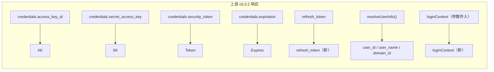
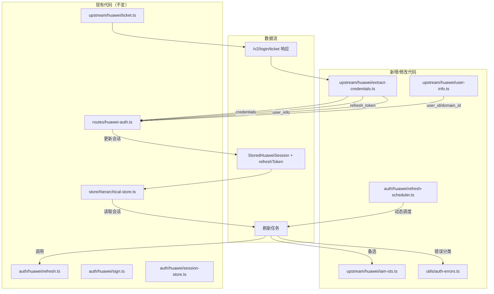
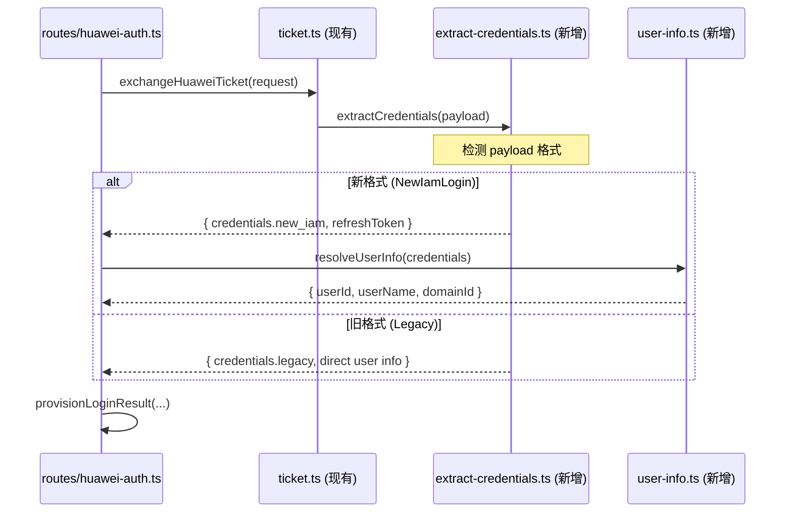
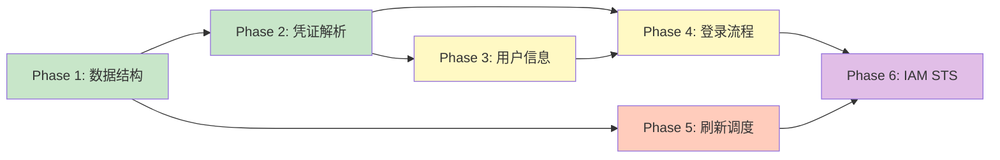

# 上游 huaweicloud.authentication v5.0.2 认证逻辑移植设计

> 目标：将 CodeArts Agent `huaweicloud.authentication` 扩展 v5.0.2 中的新版 IAM 认证逻辑（`NewIamLogin`）移植到本项目 `codearts-agent-proxy`。

---

## 目录

1. [背景与动机](#1-背景与动机)
2. [上游 v5.0.2 关键变化](#2-上游-v502-关键变化)
3. [当前项目与上游差距分析](#3-当前项目与上游差距分析)
4. [架构设计](#4-架构设计)
5. [数据结构设计](#5-数据结构设计)
6. [接口与流程设计](#6-接口与流程设计)
7. [实现路线图](#7-实现路线图)
8. [风险与缓解措施](#8-风险与缓解措施)

---

## 1. 背景与动机

### 1.1 为什么移植

`codearts-agent-proxy` 作为华为云 CodeArts Agent LLM API 的 OpenAI 兼容代理，其认证流程参照了上游 `huaweicloud.authentication` 扩展的实现。上游 v5.0.2 引入了**新版 IAM 登录流程**（`NewIamLogin`），在 API 响应格式、凭证字段、令牌刷新路径上均有变化。为保持与上游最新 API 的兼容性，需要将新版认证逻辑移植到本项目中。

### 1.2 适用范围

本设计仅针对上游 v5.0.2 **新 IAM 登录路径**（`LoginWay.NewIamLogin`）的移植，**不涉及旧版凭证格式**（`credential.access` / `secret` / `securitytoken` / `expires_at`）的解析。移植后旧版认证流程仍可继续工作，新旧格式在运行时共存。

---

## 2. 上游 v5.0.2 关键变化

### 2.1 登录方式枚举

```javascript
// 上游 v5.0.2 新增枚举
this.loginWay = LoginWay.NewIamLogin; // 默认值
```

### 2.2 API 响应格式变化

| 字段 | 旧格式 (Old) | 新格式 (NewIamLogin) |
|------|-------------|---------------------|
| AK | `credential.access` | `credentials.access_key_id` |
| SK | `credential.secret` | `credentials.secret_access_key` |
| Token | `credential.securitytoken` | `credentials.security_token` |
| 过期时间 | `credential.expires_at` | `credentials.expiration` |
| 刷新令牌 | 无 | `refresh_token` |
| 登录上下文 | 无 | `loginContext`（函数参数） |

### 2.3 Session 类构造函数变化

```javascript
// 旧: 8 个参数
new S(account, scopes, accessToken, accessKey, secretKey, securityToken, expiresAt, domainId)

// 新: 10 个参数
new S(account, scopes, accessToken, accessKey, secretKey, securityToken, expiresAt, domainId, loginContext, refreshToken)
```

### 2.4 登录流程变化

```text
旧流程:
  ticket 交换响应
    → 直接从响应中提取 user_id, user_name, domain_id, credential
    → 创建 Session

新流程:
  ticket 交换响应
    → resolveUserInfo(authResult)        ← 新增: 通过 IAM API 获取用户信息
      → 返回 { user_id, user_name, domain_id }
    → 从 credentials 中提取 AK/SK/Token
    → 提取 refresh_token                 ← 新增
    → 传入 loginContext                  ← 新增
    → 创建 Session
```

### 2.5 新增的 IAM STS 端点

上游 `ApiService` 类还新增了 IAM STS 端点用于备用凭证获取：

```text
POST /v3.0/OS-CREDENTIAL/securitytokens
  Header: X-Auth-Token: {token}
  Body: { "auth": { "identity": { "methods": ["token"], "token": { "duration_seconds": 86400 } } } }
```

### 2.6 新增字段映射总结



---

## 3. 当前项目与上游差距分析

### 3.1 数据结构差距

| 字段 | 本项目当前 | 上游 v5.0.2 |
|------|-----------|-------------|
| `accessKey` | ✅ `session.accessKey` | `credentials.access_key_id` |
| `secretKeyCiphertext` | ✅ AES-256-GCM 加密存储 | VS Code Secret Storage |
| `securityToken` | ✅ `session.securityToken` | `credentials.security_token` |
| `expiresAt` | ✅ `session.expiresAt` | `credentials.expiration` |
| `refreshToken` | ❌ **缺失** | `refresh_token` |
| `loginContext` | ❌ **缺失** | `loginContext`（参数传入） |
| `loginWay` | ❌ **缺失** | `LoginWay.NewIamLogin` |
| 用户信息获取 | ✅ 从 ticket 响应提取 | `resolveUserInfo()` IAM API 查询 |

### 3.2 刷新机制差距

| 特性 | 本项目当前 | 上游 v5.0.2 |
|------|-----------|-------------|
| 调度方式 | `setInterval` 固定 10 分钟 | `setTimeout` 动态计算 |
| 刷新时间计算 | 固定 2 小时阈值 | `expires_at - now - 2h - random(0-59s)` |
| reflesh_token 支持 | ❌ **缺失** | 支持 |
| 错误类型分类 | 简单 `try/catch` | `IAMRequestErrorType` 枚举 |

### 3.3 API 端点覆盖率

| 端点 | 本项目 | 上游 |
|------|--------|------|
| `POST /v2/login/ticket` | ✅ `ticket.ts` | ✅ |
| `POST /v2/login/refresh` | ✅ `refresh.ts` | ✅ |
| `POST /v3.0/OS-CREDENTIAL/securitytokens` | ❌ **缺失** | ✅ |
| 用户信息查询 | ❌ 直接从 ticket 响应解析 | ✅ `resolveUserInfo` |

---

## 4. 架构设计

### 4.1 设计原则

1. **无侵入扩展** — 不改动现有认证流程代码，新增逻辑通过扩展点注入
2. **运行时兼容** — 新旧格式 session 可共存，新 API 响应用新格式解析
3. **渐进式实现** — 按 Phase 分步上线，每 Phase 可独立部署验证
4. **透明升级** — 现有运行中的 session 不受影响，新的 ticket 交换自动使用新格式

### 4.2 架构图



### 4.3 模块职责

| 模块 | 职责 | 类型 |
|------|------|------|
| `extract-credentials.ts` | 从 ticket 响应中解析新/旧格式凭证 + refresh_token | **新增** |
| `user-info.ts` | 通过 IAM API 获取用户信息 | **新增** |
| `iam-sts.ts` | X-Auth-Token → 临时凭证（备用） | **新增** |
| `auth-errors.ts` | IAMRequestErrorType 枚举 + 错误处理 | **新增** |
| `refresh-scheduler.ts` | 动态 setTimeout 调度逻辑 | **新增** |
| `session-store.ts` | 接口扩展（新增字段） | **修改** |
| `huawei-auth.ts` | 登录流程集成 resolveUserInfo | **修改** |

---

## 5. 数据结构设计

### 5.1 StoredHuaweiSession 扩展

```typescript
// src/auth/huawei/session-store.ts

export interface StoredHuaweiSession {
  /** 现有字段 - 保持不变 */
  keyId: string;
  providerAccountId: string;
  businessToken?: string;
  accessKey?: string;
  secretKeyCiphertext?: string;
  securityToken?: string;
  expiresAt?: string;
  lastRefreshedAt?: string;

  /** v5.0.2 新增字段 */
  /** IAM 颁发的刷新令牌，用于 AK/SK 签名刷新失败时的降级路径 */
  refreshToken?: string;
  /** IAM 登录上下文标识，区分不同的 IAM 登录会话 */
  loginContext?: string;
  /** 凭证来源格式标识 */
  credentialFormat?: 'new_iam' | 'legacy';
}
```

### 5.2 凭证解析结果类型

```typescript
// src/upstream/huawei/extract-credentials.ts

/**
 * 统一凭证提取结果。
 * 同时兼容旧格式 (credential.access) 和新格式 (credentials.access_key_id)。
 */
export interface ExtractedCredentials {
  /** 访问密钥 ID (AK) */
  accessKey?: string;
  /** 秘密访问密钥 (SK) */
  secretKey?: string;
  /** 安全令牌 */
  securityToken?: string;
  /** 过期时间 ISO 8601 */
  expiresAt?: string;
}

export interface TicketExchangeParsedResult {
  /** 用户 ID */
  userId?: string;
  /** 用户名 */
  userName?: string;
  /** 租户 ID */
  domainId?: string;
  /** 业务 Token */
  businessToken?: string;
  /** 凭证信息 */
  credentials: ExtractedCredentials;
  /** IAM 刷新令牌（新格式独有） */
  refreshToken?: string;
  /** 凭证格式来源 */
  credentialFormat: 'new_iam' | 'legacy';
  /** 原始响应（调试用） */
  raw: unknown;
}
```

### 5.3 用户信息类型

```typescript
// src/upstream/huawei/user-info.ts

export interface HuaweiUserInfo {
  userId: string;
  userName: string;
  domainId: string;
}
```

### 5.4 错误类型枚举

```typescript
// src/utils/auth-errors.ts

/**
 * IAM 请求错误类型，对标上游 EXCEPTIONS 枚举。
 * 用于结构化错误分类和恢复策略。
 */
export enum IAMRequestErrorType {
  UNAUTHORIZED = "Authentication Error",
  PROXY = "Proxy Authentication Error",
  FORBIDDEN_TOKEN = "IAM.1201",
  FORBIDDEN_API_ACCESS = "not programmatic access",
  TIMEOUT = "Login Timeout",
  FAILED = "Login Failed",
  USER_CANCELED = "User Canceled",
  SYSTEM_CANCELED = "System Canceled",
  USER_OR_PWD = "Invalid user name or password",
  ACCOUNT_LOCKED = "The account is locked.",
  ACCOUNT_DISABLED = "The account is disabled.",
  EXPIRED_REFRESH_TOKEN = "Expired refresh token",
}

/**
 * HTTP 级错误码枚举，对标上游 EXCEPTIONS_CODE。
 */
export enum IAMHttpErrorCode {
  UNAUTHORIZED = 401,
  FORBIDDEN = 403,
  PROXY = 407,
  TIMEOUT = 408,
  CODE_ERROR = 460,
  GATEWAY_TIMEOUT = 504,
}
```

### 5.5 刷新调度状态类型

```typescript
// src/auth/huawei/refresh-scheduler.ts

export interface RefreshSchedule {
  /** 下次刷新时间的时间戳 */
  nextRefreshAt: number;
  /** 是否正在执行刷新 */
  isRunning: boolean;
  /** 定时器引用 */
  timerRef: NodeJS.Timeout | null;
}
```

---

## 6. 接口与流程设计

### 6.1 Ticket 响应解析流程（核心变更）



### 6.2 `extract-credentials.ts` 接口设计

```typescript
// src/upstream/huawei/extract-credentials.ts

import type { HuaweiTicketExchangeResponse } from "./ticket";

export interface NewIamCredentials {
  access_key_id: string;
  secret_access_key: string;
  security_token: string;
  expiration: string;
}

export interface NewIamLoginPayload {
  credentials: NewIamCredentials;
  refresh_token: string;
  // 新格式中 user_id/user_name/domain_id 可能需要通过 resolveUserInfo 获取
  // 也可能直接在 payload 顶层，视 IAM API 版本而定
  user_id?: string;
  user_name?: string;
  domain_id?: string;
}

export interface LegacyLoginPayload {
  user_id: string;
  user_name: string;
  domain_id: string;
  credential: {
    access: string;
    secret: string;
    securitytoken: string;
    expires_at: string;
  };
}

/**
 * 检测 ticket 交换响应是否为 NewIamLogin 格式。
 * 判断依据：顶层存在 credentials.access_key_id 字段。
 */
export function isNewIamLoginPayload(
  payload: Record<string, unknown>,
): payload is NewIamLoginPayload {
  const creds = payload.credentials as Record<string, unknown> | undefined;
  return typeof creds?.access_key_id === "string";
}

/**
 * 从新格式 payload 提取 credentials。
 */
export function extractNewIamCredentials(
  payload: NewIamLoginPayload,
): HuaweiTicketExchangeResponse {
  return {
    userId: payload.user_id,
    userName: payload.user_name,
    domainId: payload.domain_id,
    credentials: {
      accessKey: payload.credentials.access_key_id,
      secretKey: payload.credentials.secret_access_key,
      securityToken: payload.credentials.security_token,
      expiresAt: payload.credentials.expiration,
    },
    raw: payload,
  };
}

/**
 * 从新格式 payload 提取 refresh_token。
 */
export function extractRefreshToken(
  payload: NewIamLoginPayload,
): string | undefined {
  return payload.refresh_token;
}
```

### 6.3 `user-info.ts` 接口设计

```typescript
// src/upstream/huawei/user-info.ts

import { config } from "../../config";
import { signRequest, type SigningCredentials } from "../../auth/huawei/sign";
import type { HuaweiUserInfo } from "./types";

/**
 * 通过 IAM API 获取用户信息。
 *
 * 使用 AK/SK 签名调用 IAM 接口查询当前用户信息。
 * 新 IAM 登录流程要求先获取 credentials，再通过 IAM API 获取 user info。
 */
export async function resolveUserInfo(
  credentials: SigningCredentials,
): Promise<HuaweiUserInfo> {
  const url = `${config.huaweiIamHost}/v3/user/info`;
  // 或使用 /v3/projects 等端点
  // 具体端点需根据 IAM API 文档确认

  const signedHeaders = signRequest(
    { method: "GET", url, headers: {} },
    credentials,
  );

  const response = await fetch(url, {
    method: "GET",
    headers: {
      ...signedHeaders,
      "X-Security-Token": credentials.securityToken ?? "",
    },
  });

  if (!response.ok) {
    throw new Error(`resolveUserInfo failed: ${response.status}`);
  }

  const data = await response.json();
  return {
    userId: data.user_id ?? data.id,
    userName: data.user_name ?? data.name,
    domainId: data.domain_id ?? data.domain.id,
  };
}
```

### 6.4 `iam-sts.ts` 接口设计（备用路径）

```typescript
// src/upstream/huawei/iam-sts.ts

import { config } from "../../config";
import type { ExtractedCredentials } from "./extract-credentials";

/**
 * 通过 X-Auth-Token 获取 IAM 临时凭证（备用刷新路径）。
 *
 * 当 refresh_token 存在且 AK/SK 签名刷新失败时，可降级使用此路径。
 */
export async function getCredentialsByToken(
  businessToken: string,
): Promise<ExtractedCredentials> {
  const url = `${config.huaweiIamHost}/v3.0/OS-CREDENTIAL/securitytokens`;
  const body = JSON.stringify({
    auth: {
      identity: {
        methods: ["token"],
        token: { duration_seconds: 86400 },
      },
    },
  });

  const response = await fetch(url, {
    method: "POST",
    headers: {
      "Content-Type": "application/json",
      "X-Auth-Token": businessToken,
    },
    body,
  });

  if (!response.ok) {
    throw new Error(`getCredentialsByToken failed: ${response.status}`);
  }

  const data = await response.json();
  const credential = data.credential ?? {};

  return {
    accessKey: credential.access,
    secretKey: credential.secret,
    securityToken: credential.securitytoken,
    expiresAt: credential.expires_at,
  };
}
```

### 6.5 刷新调度器设计

```typescript
// src/auth/huawei/refresh-scheduler.ts

export class RefreshScheduler {
  private timer: NodeJS.Timeout | null = null;
  private isRunning = false;

  /**
   * 计算下次刷新延迟（毫秒）。
   *
   * 算法（对标上游 getFirstRefreshTime）：
   *   1. 如果 expiresAt 不存在 → 立即刷新
   *   2. 计算 now + 2h 作为安全刷新点
   *   3. 如果安全点 >= 过期时间 → 立即刷新
   *   4. 在安全点上加上随机秒数 (0-59) 以打散刷新请求
   *   5. 返回距当前时间的毫秒数
   */
  calculateNextDelay(expiresAt?: string): number {
    if (!expiresAt) return 0;

    const now = Date.now();
    const expires = new Date(expiresAt).getTime();
    if (isNaN(expires)) return 0;

    // 已过期 → 不刷新（需要重新登录）
    if (expires <= now) return -1;

    // 在过期前 2 小时 + 随机秒数刷新
    const safePoint = now + 2 * 60 * 60 * 1000;
    if (safePoint >= expires) return 0;

    const target = new Date(safePoint);
    target.setSeconds(Math.floor(60 * Math.random()));
    const delay = target.getTime() - now;
    return delay > 0 ? delay : 0;
  }

  /**
   * 注册下一次刷新。
   * 每次刷新成功后自动重新计算并注册下一次。
   */
  schedule(expiresAt: string | undefined, refreshFn: () => Promise<void>): void {
    this.cancel();
    const delay = this.calculateNextDelay(expiresAt);

    if (delay < 0) {
      // 已过期，不刷新
      return;
    }

    if (delay === 0) {
      // 需要立即刷新
      this.executeRefresh(refreshFn);
      return;
    }

    this.timer = setTimeout(() => {
      this.executeRefresh(refreshFn);
    }, delay);
  }

  private async executeRefresh(refreshFn: () => Promise<void>): Promise<void> {
    if (this.isRunning) return;
    this.isRunning = true;
    try {
      await refreshFn();
    } finally {
      this.isRunning = false;
    }
  }

  cancel(): void {
    if (this.timer) {
      clearTimeout(this.timer);
      this.timer = null;
    }
  }
}
```

### 6.6 登录流程集成点

在现有 `routes/huawei-auth.ts` 的 `provisionLoginResult` 函数中接入新格式处理：

```typescript
// routes/huawei-auth.ts — 变更点

import { isNewIamLoginPayload, extractNewIamCredentials, extractRefreshToken } from "../upstream/huawei/extract-credentials";
import { resolveUserInfo } from "../upstream/huawei/user-info";

export function provisionLoginResult(
  flow: LoginFlowRecord,
  result: HuaweiTicketExchangeResponse,  // ← 现有类型
): { accountId: string; apiKeyId: string; apiKey: string } {
  // 新增：检测 ticket 交换响应格式
  const rawPayload = result.raw as Record<string, unknown>;

  if (isNewIamLoginPayload(rawPayload)) {
    return provisionNewIamLoginResult(flow, rawPayload);
  }

  // 旧格式走现有逻辑（保持不变）
  return provisionLegacyLoginResult(flow, result);
}

async function provisionNewIamLoginResult(
  flow: LoginFlowRecord,
  payload: NewIamLoginPayload,
): Promise<{ accountId: string; apiKeyId: string; apiKey: string }> {
  // 1. 提取凭证
  const creds = extractNewIamCredentials(payload);

  // 2. 通过 IAM API 获取用户信息
  const signCreds: SigningCredentials = {
    accessKey: creds.credentials.accessKey!,
    secretKey: creds.credentials.secretKey!,
    securityToken: creds.credentials.securityToken,
  };
  const userInfo = await resolveUserInfo(signCreds);

  // 3. 提取 refresh_token
  const refreshToken = extractRefreshToken(payload);

  // 4. 创建 provider account（复用现有逻辑）
  const accountId = `huawei-${userInfo.domainId}`;
  // ... 现有 upsertProviderAccount 逻辑

  // 5. 存储 session 时增加新字段
  storeSession(apiKeyObj.id, {
    keyId: apiKeyObj.id,
    providerAccountId: accountId,
    businessToken: creds.businessToken,
    accessKey: creds.credentials.accessKey,
    secretKeyCiphertext: encryptString(creds.credentials.secretKey!),
    securityToken: creds.credentials.securityToken,
    expiresAt: creds.credentials.expiresAt,
    refreshToken,           // ← 新增
    loginContext: "",       // ← 新增
    credentialFormat: "new_iam",  // ← 新增
  });

  return { accountId, apiKeyId: apiKeyObj.id, apiKey: rawKey };
}
```

---

## 7. 实现路线图

### Phase 1 — 数据层准备

**目标**：扩展数据结构，新增错误类型枚举，为上层变更提供基础。

| 待办 | 涉及文件 | 评估工时 |
|------|----------|----------|
| 扩展 `StoredHuaweiSession` 接口 | `src/auth/huawei/session-store.ts` | 小 |
| 新增 `IAMRequestErrorType` 枚举 | `src/utils/auth-errors.ts` | 小 |
| 新增 `ExtractedCredentials` 类型 | 新文件 | 小 |

**验证方式**：
- `pnpm build` 编译通过，类型检查通过
- 现有测试全部通过

---

### Phase 2 — 凭证解析层

**目标**：实现新格式检测和解析，与现有 ticket 交换流程集成。

| 待办 | 涉及文件 | 评估工时 |
|------|----------|----------|
| 实现 `isNewIamLoginPayload` 检测函数 | `src/upstream/huawei/extract-credentials.ts` | 小 |
| 实现 `extractNewIamCredentials` 解析函数 | 同上 | 小 |
| 实现 `extractRefreshToken` 函数 | 同上 | 小 |
| 在 ticket.ts 中集成格式检测 | `src/upstream/huawei/ticket.ts` | 中 |

**验证方式**：
- 用 mock 数据测试新旧格式的自动检测
- 手动验证 ticket 交换响应能正确识别新格式

---

### Phase 3 — 用户信息查询

**目标**：实现通过 IAM API 获取用户信息的能力。

| 待办 | 涉及文件 | 评估工时 |
|------|----------|----------|
| 实现 `resolveUserInfo` 函数 | `src/upstream/huawei/user-info.ts` | 中 |
| 确认正确的 IAM 用户信息端点 | N/A（需测试） | 中 |

**风险**：需要确认 IAM API 的具体端点（`/v3/user/info` 或 `/v3/projects`），可能需要在生产环境中测试确认。

---

### Phase 4 — 登录流程集成

**目标**：将新格式和用户信息查询集成到登录路由中。

| 待办 | 涉及文件 | 评估工时 |
|------|----------|----------|
| 在 `provisionLoginResult` 中添加格式分支 | `src/routes/huawei-auth.ts` | 中 |
| 实现 `provisionNewIamLoginResult` | 同上 | 大 |
| 存储 `refreshToken`、`credentialFormat` 字段 | 同上 | 小 |
| 添加 `loginContext` 支持 | 同上 | 小 |

**验证方式**：
- 完整的新格式登录流程 E2E 测试
- 验证 `refresh_token` 正确存储在 session 中

---

### Phase 5 — 刷新调度升级

**目标**：将固定间隔刷新改为动态调度。

| 待办 | 涉及文件 | 评估工时 |
|------|----------|----------|
| 实现 `RefreshScheduler` 类 | `src/auth/huawei/refresh-scheduler.ts` | 中 |
| 将 `refresh-task.ts` 改为使用动态调度 | `src/auth/huawei/refresh-task.ts` | 大 |
| 支持 `refresh_token` 刷新路径 | `src/auth/huawei/refresh.ts` | 中 |

**验证方式**：
- 单元测试 `RefreshScheduler.calculateNextDelay` 的边界值
- 模拟 Token 过期场景，验证刷新在正确时间触发

---

### Phase 6 — IAM STS 备用路径（可选）

**目标**：实现 `X-Auth-Token` → 临时凭证的备用路径。

| 待办 | 涉及文件 | 评估工时 |
|------|----------|----------|
| 实现 `getCredentialsByToken` | `src/upstream/huawei/iam-sts.ts` | 中 |
| 在刷新失败时降级使用 | `src/auth/huawei/refresh-scheduler.ts` | 大 |

**验证方式**：模拟 AK/SK 签名刷新失败 → 自动降级到 IAM STS 路径 → Token 刷新成功

---

### 依赖图



---

## 8. 风险与缓解措施

### 8.1 风险矩阵

| 风险 | 概率 | 影响 | 缓解措施 |
|------|------|------|----------|
| IAM 用户信息 API 端点不确定 | 高 | 中 | Phase 3 先做技术验证，确认后设计 |
| `refresh_token` 有效期未知 | 中 | 中 | 过期的 refresh_token 降级到 AK/SK 刷新 |
| 登录流程新增 API 调用增加延迟 | 中 | 低 | resolveUserInfo 可与凭证提取并行 |
| 现有 session 与新字段不兼容 | 低 | 高 | 所有读取 session 的代码加 Optional Chaining |
| 上游 API 响应格式变化 | 低 | 高 | 通过 isNewIamLoginPayload 自动适配 |

### 8.2 兼容性策略

1. **向后兼容**：所有新增字段均为 `optional`（`?`），旧 session 读取不受影响
2. **格式自检**：`credentialFormat` 字段记录凭证来源，刷新时选择对应路径
3. **降级路径**：`refreshToken` 刷新失败 → 回退到 AK/SK 签名刷新
4. **灰度策略**：Phase 1-2 可独立上线，不影响现有认证流程

### 8.3 监控与可观测性

1. `resolveUserInfo` 的成功/失败率
2. 新旧格式登录量的分布
3. `refresh_token` 刷新成功率 vs AK/SK 刷新成功率
4. `RefreshScheduler` 的调度延迟偏差

---

## 附录 A：文件变更清单

| 文件 | 变更类型 | 说明 |
|------|----------|------|
| `src/auth/huawei/session-store.ts` | **修改** | 接口增加 `refreshToken`, `loginContext`, `credentialFormat` |
| `src/upstream/huawei/extract-credentials.ts` | **新增** | 凭证格式检测和解析 |
| `src/upstream/huawei/user-info.ts` | **新增** | IAM 用户信息查询 |
| `src/upstream/huawei/iam-sts.ts` | **新增** | Token → 凭证备用路径 |
| `src/utils/auth-errors.ts` | **新增** | IAMRequestErrorType 枚举 |
| `src/auth/huawei/refresh-scheduler.ts` | **新增** | 动态刷新调度器 |
| `src/routes/huawei-auth.ts` | **修改** | 登录流程集成新格式 |
| `src/upstream/huawei/ticket.ts` | **修改** | 集成 extract-credentials |
| `src/auth/huawei/refresh.ts` | **修改** | 新增 refresh_token 路径 |
| `src/auth/huawei/refresh-task.ts` | **修改** | 使用 RefreshScheduler |

## 附录 B：参考文献

- 上游反混淆源码：`docs/prettified/authentication.plugin.prettier.js`
- 认证机制文档：`docs/auth-mechanism.md`
- 上游插件安装目录：`D:\Program Files\CodeArts Agent\resources\app\extensions\huaweicloud.authentication`
- 认证调查补充：`docs/auth-investigation-supplement.md`
